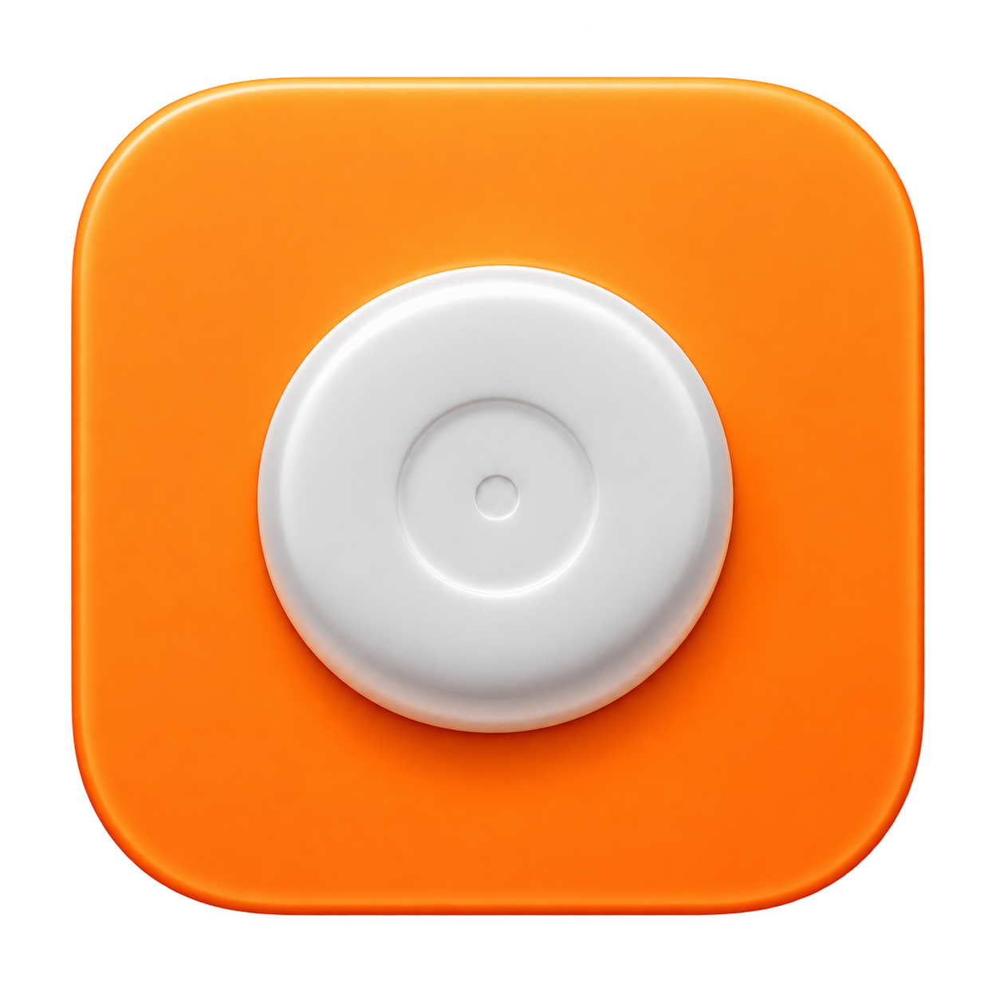
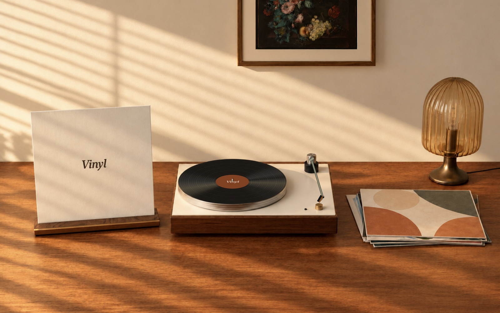
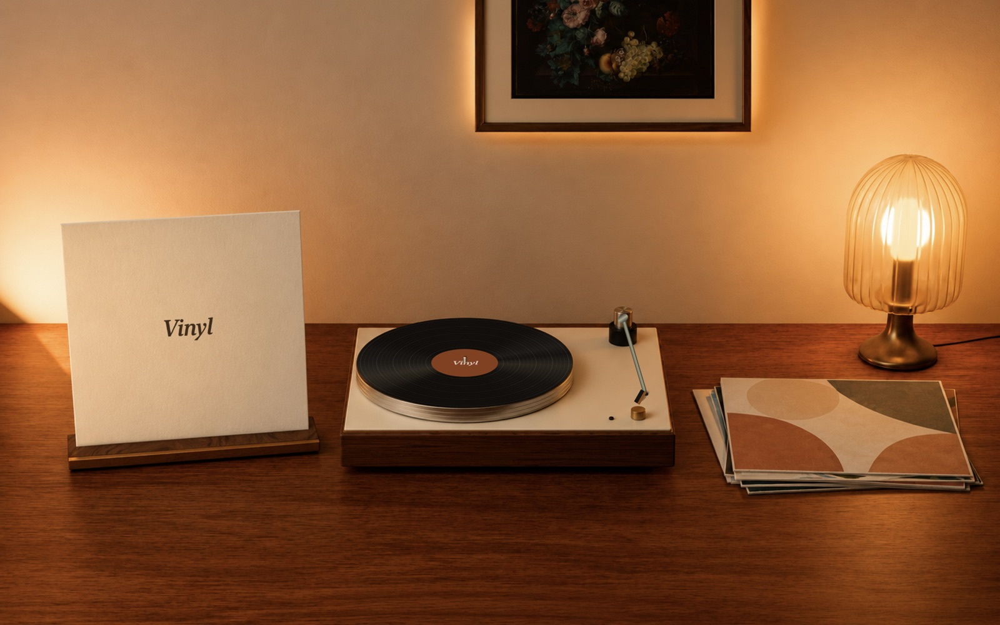

<div align="center">
  
  <h1>Vinyl</h1>
  <p><strong>Your music. A room to listen in.</strong></p>
  <p>A native macOS wallpaper that turns your desktop into a warm listening room.<br>Live album artwork. A spinning record. A little space to slow down.</p>
  <p><a href="https://github.com/xbahodirovich/vinyl/releases/latest"><strong>Download the DMG</strong></a> &nbsp;·&nbsp; <a href="#install">Install</a> &nbsp;·&nbsp; <a href="docs/BROWSER_SETUP.md">Browser setup</a> &nbsp;·&nbsp; <a href="docs/DEVELOPMENT.md">Build it yourself</a></p>
  <p><code>macOS 14+</code> &nbsp; <code>Apple Silicon + Intel</code> &nbsp; <code>Menu bar app</code></p>
</div>



## Let the record play

Vinyl lives behind your desktop icons and app windows. Open your music player, start a song, and its cover appears on the sleeve and record label. The disc turns at 33⅓ RPM while playing and holds its angle when paused. The tonearm stays above the paused record with a subtle stylus lift.

- **A room for every mood.** Sunlit wood in Listening Room; warm lamplight in After Hours.
- **Your desktop, still yours.** Click-through wallpaper windows on every connected display, configured to follow Spaces.
- **Keep your own backdrop.** Hide the room background and keep the turntable and sleeve over your existing wallpaper.
- **Quiet when paused.** Compositor-driven rotation stops entirely when paused, hidden, or occluded. Reduce Motion is respected.

<table>
<tr><th>Player</th><th>Desktop app</th><th>Browser</th></tr>
<tr><td>Yandex Music</td><td>Supported through macOS Now Playing</td><td>Chrome / Edge companion extension</td></tr>
<tr><td>Spotify</td><td>Supported through macOS Now Playing</td><td>No dedicated browser integration</td></tr>
<tr><td>Apple Music</td><td>Supported through macOS Now Playing</td><td>No dedicated browser integration</td></tr>
</table>

Desktop detection depends on the player publishing a macOS Now Playing session. Safari integration is not implemented.

## Install

1. Open [the latest release](https://github.com/xbahodirovich/vinyl/releases/latest) and download **Vinyl-…dmg** under **Assets**.
2. Open the DMG and drag **Vinyl → Applications**.
3. Eject the disk and open Vinyl from Applications.
4. Look for the **disc icon in the menu bar**, then start your music.

Vinyl has no Dock icon or normal app window. The orange logo is its Finder app icon; the small menu-bar disc opens its controls.

> **Development builds:** releases are ad-hoc signed and are **not Apple-notarized**. If macOS blocks a copy you trust, follow [Apple’s opening instructions](https://support.apple.com/102445). Never disable Gatekeeper globally. Download integrity checks and signing status are explained in [the installation guide](docs/INSTALLATION.md).

The release link becomes available after the first version tag has produced a GitHub Release. Until then, [build a DMG locally](docs/DEVELOPMENT.md).

## Make it yours

| Menu setting | What it does |
| :--- | :--- |
| **Show Wallpaper** | Hide or restore Vinyl |
| **Scene Background** | Switch between the listening room and your existing wallpaper |
| **Room Lighting** | Choose Listening Room or After Hours |
| **High-Resolution Yandex Covers** | Opt in to matching 1000-pixel catalogue covers; off on a new installation |
| **Music Source** | Follow the active supported player or filter to one source |
| **Previous / Play / Pause / Next** | Control the selected player |
| **Reconnect** | Restart the Now Playing connection |



## Privacy, plainly

**No Vinyl account, analytics service, microphone access, or app backend.**

| Feature | Information used | Where it goes |
| :--- | :--- | :--- |
| Desktop detection | Active track, artist, artwork and playback state | Read locally from macOS |
| Browser bridge | Yandex tab’s Media Session metadata | Local native-messaging host and local app notifications |
| Browser cover | Artwork URL supplied by Yandex Music | HTTPS request to approved Yandex artwork hosts |
| Optional sharper covers | Current Yandex track title and artist | Yandex’s public catalogue, only when you enable the setting |

Artwork requests use an ephemeral network session without persistent URL caches or cookies. Redirects are refused. Up to four high-resolution covers are cached in memory. Settings live in macOS preferences. See [SECURITY.md](SECURITY.md) for trust boundaries and reporting concerns.

## A few honest limits

- Uses a vendored helper that accesses a **private macOS MediaRemote interface**. OS or player updates can break detection; App Store distribution is not established.
- Follows one active desktop session. Source selection filters received data; it cannot make macOS publish a different background player.
- Changes the unlocked desktop only. Lock and login screens keep the system wallpaper.
- The room fills the display, so portrait or narrow screens can crop side objects.
- Physical monitor hot-plugging, Space gestures, Stage Manager, Intel hardware, and long-duration battery use still need broader testing. Short app-only CPU checks exclude the helper and GPU.

## Build, contribute, release

```sh
# From this repository, with Xcode installed:
VINYL_UNIVERSAL=1 Scripts/build.sh
Scripts/package-dmg.sh
```

Your installer appears in `dist/`, together with a SHA-256 checksum. No signing credentials are needed for development builds.

[Development & releasing](docs/DEVELOPMENT.md) · [Browser setup](docs/BROWSER_SETUP.md) · [Contributing](CONTRIBUTING.md) · [Publication checks](docs/PUBLISHING.md)

## Credits & licensing

Inspired by [Vinyl for Mac](https://www.vinylformac.com/); this is an independent project. Scene images are generated assets based on a supplied visual reference; [provenance](Resources/Scenes/PROVENANCE.md) records the process. The app icon was supplied by the project owner. Album artwork comes from the active player and belongs to its respective owners; none is bundled in the demo screenshots.

The vendored [mediaremote-adapter](https://github.com/ungive/mediaremote-adapter) retains its [BSD 3-Clause license](Vendor/mediaremote-adapter/LICENSE). Vinyl’s original code and original project assets are **all rights reserved**; see [LICENSE](LICENSE). Public availability does not grant an open-source license or permission to reuse them in other projects. Third-party artwork and components retain their respective rights and licenses.
